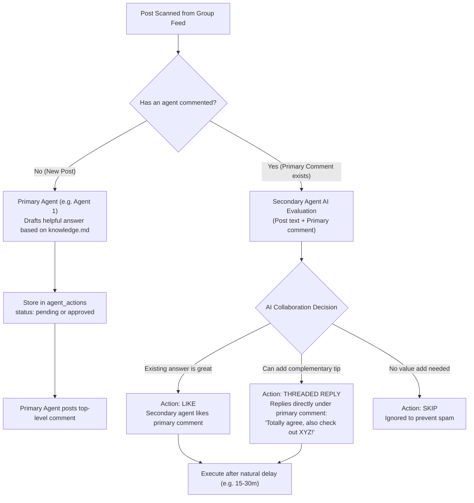

# FB Bot: Multi-Agent Travel Helper & Swarm

## Purpose
The bot automates engagement in Facebook travel and community groups from real Facebook accounts.

It can operate in two modes:
1. **Single-Agent Mode**: Reads posts in target groups, drafts helpful 1-2 sentence replies using local notes (`knowledge.md`), and posts comments after approval or auto-approval.
2. **Multi-Agent Swarm Mode (Coordinated Team)**: Multiple agents/accounts collaborate organically on posts without spamming:
   - **Primary Agent**: Detects new traveler inquiries and posts an authoritative, friendly answer.
   - **Secondary Agent(s)**: Inspects the post and the primary agent's comment:
     - **LIKE**: If the answer is already complete, the secondary agent Likes the comment to boost its algorithm ranking and social proof.
     - **THREADED REPLY**: If the secondary agent can add a complementary tip (e.g. agreeing and adding a specific local recommendation), it posts a nested reply to the primary comment after a natural human delay (e.g. 15-30 minutes).
     - **SKIP**: If the post is not relevant or already saturated, it skips to prevent unnecessary clutter.

---

## Architecture & Workflows



---

## Quick Setup

### 1. Setup Environment
```bash
# Activate virtual environment
.\.venv\Scripts\activate

# Install requirements
pip install -r requirements.txt
```

### 2. Configure Configuration & Secrets
1. Copy `config.example.yaml` to `config.yaml`:
   ```bash
   cp config.example.yaml config.yaml
   ```
2. Set your groups, destination, and define your agents:
   ```yaml
   groups:
     - https://www.facebook.com/groups/YOUR_GROUP_ID

   destination: "Lahore, Pakistan"

   agents:
     agent_1:
       name: "Ali (Food & Living)"
       persona: "a friendly local who knows street food and budget stays"
       browser_channel: chrome
       post:
         auto_post: false
         auto_post_min_confidence: high
         max_per_run: 5
         max_per_day: 15

     agent_2:
       name: "Hamza (Culture & Sights)"
       persona: "a local architecture enthusiast who loves historical sights"
       browser_channel: chrome
       post:
         auto_post: false
         auto_post_min_confidence: high
         max_per_run: 5
         max_per_day: 15
       collaboration:
         min_delay_after_primary_mins: 15
         allow_like: true
         allow_reply: true
   ```
3. Copy `.env.example` to `.env` and fill in your API key (`DASHSCOPE_API_KEY` for Qwen or `ANTHROPIC_API_KEY` for Claude).

---

## Daily Commands

### Login to Facebook Accounts
Each agent maintains its own isolated Chrome profile (`data/profiles/<agent_id>/`):
```bash
python bot.py login --agent agent_1   # Log in to Account 1
python bot.py login --agent agent_2   # Log in to Account 2
```

### Scan & Coordinate Actions
Scans target groups, drafts top-level replies for primary agent, and coordinates Likes/Replies for secondary agents:
```bash
python bot.py scan
```

### Review Queue
Interactively approve, edit, or skip pending comments, threaded replies, and likes:
```bash
python bot.py review
```

### Post Approved Actions
Executes comments, likes, and replies whose scheduled time has arrived:
```bash
python bot.py post               # Process due actions across all agents
python bot.py post --agent agent_1 # Process actions for specific agent
python bot.py post --dry-run     # Test without typing or clicking
```

### Run Full Cycle or Hourly Loop
```bash
python bot.py run                # 1 scan + post cycle
python bot.py loop --minutes 60  # Continuous hourly loop
```

### Status & History
```bash
python bot.py status             # Activity per agent, ready actions, pending review
python bot.py history            # View recent comment logs
```

### Test AI Brain Offline
```bash
# Test primary reply:
python bot.py try "Coming to Lahore next week, where should I eat?" --agent agent_1

# Test collaboration on an existing comment:
python bot.py try "Coming to Lahore next week, where should I eat?" --agent agent_2 --existing-comment "Try Waris Nihari in Anarkali!" --primary-name "Ali"
```

---

## Safety & Anti-Ban Features
- **Isolated User Profiles**: Separate browser data and cookies for each agent account.
- **Natural Time Gaps**: Configurable delays (e.g. 15-45 minutes) between primary comment and secondary reactions.
- **No Direct Paste**: Uses human typing delays (35ms per keystroke).
- **Anti-Messenger Protection**: Automatically avoids Facebook chat and messenger dialogs.
- **Daily Caps**: Enforces strict `max_per_run` and `max_per_day` per account.
